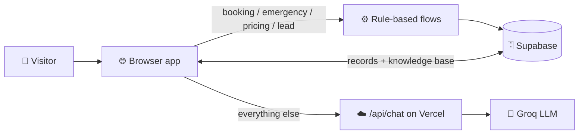

<div align="center">


<a href="https://github.com/vivekanand9/resolve-ai-front-desk">
  
</a>

<br/>


</div>

---

## ✨ What is Resolve?

**Resolve** is an AI front desk and operations hub for service and repair businesses. A chat concierge on the left handles visitors, and a live operations feed on the right lets your team manage every booking, ticket and lead.

| 💬 Front Desk AI | 📋 Operations Hub | 📚 Knowledge Base |
|---|---|---|
| Books repairs, quotes fees, escalates emergencies | Status, technician assignment, staff notes, CSV export | Edit answers once, the AI uses them instantly |

---

## 🧠 How it works



Booking, emergency, pricing and lead flows are rule-based, so records are always created correctly. Everything else goes to Groq, grounded in your Knowledge Base. If Groq is unreachable, keyword matching takes over.

---

## 🚀 Features

- 🪄 **Two-step visitor check-in** with name, phone, address and PIN validation
- 📅 **Guided booking** with appliance, time slot and a downloadable `.ics` calendar invite
- 🚨 **Emergency detection** for smoke, sparks and leaks, which raises a priority ticket and a safety warning
- 🎯 **Lead capture** for AMC and callback requests
- 🗂️ **Operations drawer** with status, technician, notes and an activity timeline
- 🔎 **Search and filters**, plus `Ctrl + K` to jump to search
- 🎙️ **Voice** input (speech-to-text) and optional read-aloud replies
- 🌗 **Light and dark themes**
- ☁️ **Cloud sync** through Supabase, with a localStorage fallback

---

## 📁 Project structure

```text
resolve/
├── index.html        # app markup
├── style.css         # styles
├── app.js            # app logic, Supabase + chat engine
├── config.js         # Supabase URL + publishable key
├── api/
│   └── chat.js       # Vercel serverless function → Groq
├── supabase.sql      # tables + demo policies
├── server.js         # local dev server
├── open.bat          # Windows launcher
├── vercel.json
├── package.json
└── .env.example      # template for GROQ_API_KEY
```

---

## ⚡ Quick start

**1. Create the database**
Open Supabase → SQL Editor → paste `supabase.sql` → Run.

**2. Add your keys**
```js
// config.js  (public values)
window.RESOLVE_CONFIG = {
  SUPABASE_URL: 'https://YOUR-PROJECT.supabase.co',
  SUPABASE_ANON_KEY: 'YOUR_PUBLISHABLE_KEY'
};
```
```bash
# .env  (private, never commit)
GROQ_API_KEY=your_groq_key
```

**3. Run locally** (Node 18+)
```bash
node server.js
```
Then open **http://localhost:3000**.

---

## ▲ Deploy to Vercel

1. Push this folder to GitHub (`.env` is git-ignored).
2. Import the repo on [vercel.com](https://vercel.com), with framework **Other** and no build command.
3. Add the environment variable `GROQ_API_KEY`.
4. Click **Deploy** 🎉

---

## 🔐 Before going to production

> [!WARNING]
> - The demo SQL policies let anyone with the public key read and write all rows. Add **Supabase Auth** and tighter row-level security before real customers use it.
> - The check-in form is not authentication.
> - Add proper rate limiting (Upstash or Vercel KV) to `/api/chat`.
> - Never commit `.env` or your Groq and Supabase secret keys.

---

## ⌨️ Shortcuts

| Key | Action |
|---|---|
| `Ctrl` / `Cmd` + `K` | Focus search |
| `Esc` | Close drawer or modal |
| `Enter` | Send message |

---

<div align="center">

Built with ❤️ using vanilla JS, Groq, Supabase and Vercel


</div>
